# Mission 1-1: 개발 워크스테이션 구축

## 1. 프로젝트 개요
터미널, Docker, Git을 직접 세팅하며 재현 가능한 개발 환경을 구축한다.
이미지/컨테이너 분리, 포트 매핑, 바인드 마운트, 볼륨 영속성을 직접 검증한다.
같은 서비스를 여러 번 실행해도 재현되는 환경을 만드는 사고방식을 경험하는 것이 목표이다.

---

## 2. 프로젝트 디렉토리 구조

    mission1-1/
    ├── docker-web/          # Nginx 커스텀 이미지 빌드 실습 폴더
    │   ├── Dockerfile       # nginx 이미지 빌드 설정 파일
    │   └── app/             # nginx에 배포할 정적 HTML 파일
    │       └── index.html
    ├── images/              # 실습 증거 스크린샷 보관
    ├── pratice/             # 명령어 연습용 임시 파일 저장
    └── README.md            # 프로젝트 전체 문서

### 폴더 역할 설명
| 폴더 | 역할 |
|------|------|
| docker-web/ | Dockerfile 및 nginx 서비스 파일 관리 |
| docker-web/app/ | 컨테이너에 복사될 정적 웹 파일 보관 |
| images/ | 브라우저 접속·명령 실행 캡처 스크린샷 저장 |
| pratice/ | 터미널 명령어 연습용 임시 파일 저장 |

---

## 3. 실행 환경

| 항목 | 버전/정보 |
|------|----------|
| OS | Ubuntu 22.04 |
| Shell | Bash |
| Docker | v29.9.3 |
| Git | v2.34.1 |
| WSL2 | v3.0.5.0 |

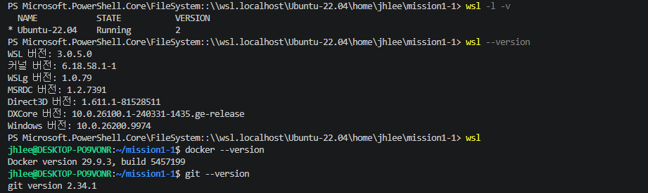

---

## 4. 수행 항목 체크리스트

- [O] 터미널 기본 조작 (pwd, ls, mkdir, cd, touch, cat, cp, mv, rm)
- [O] 파일/디렉토리 권한 확인 및 변경 (chmod)
- [O] Docker 설치 및 기본 점검
- [O] Docker 기본 운영 명령 (images, ps, logs, stats)
- [O] hello-world / ubuntu 컨테이너 실행
- [O] Dockerfile 기반 커스텀 이미지 제작 (nginx)
- [O] 포트 매핑 및 브라우저 접속 확인
- [O] 바인드 마운트 변경 반영 확인
- [O] Docker 볼륨 영속성 검증
- [O] Git 설정 및 GitHub 연동

---

## 4. 검증 방법

### 4-1. 터미널 조작 로그

    # 현재 위치 확인, 목록 확인(숨김 파일 포함), 이동, 생성, 
      복사, 이동/이름변경, 삭제
    
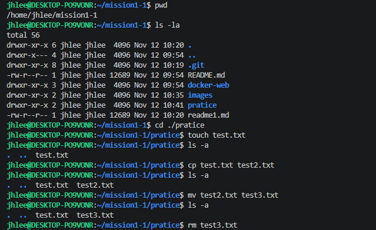

---

### 4-2. 권한 실습

    # 파일 권한 확인, 변경
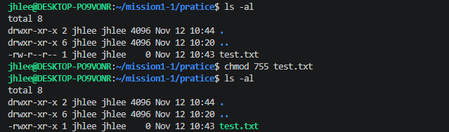
    
    # 디렉토리 권한 확인, 변경
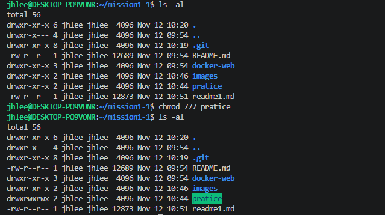

---

### 4-3. Docker 설치 및 기본 점검

    # 버전 확인, 데몬 동작 확인
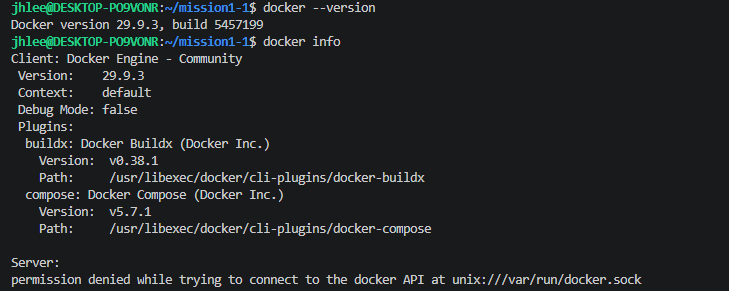

---

### 4-4. Docker 기본 운영 명령 수행

    # 이미지 다운로드/목록 확인, 컨테이너 목록 확인
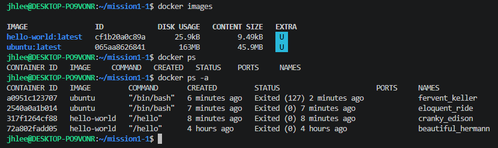

    # 로그 확인, 리소스 확인
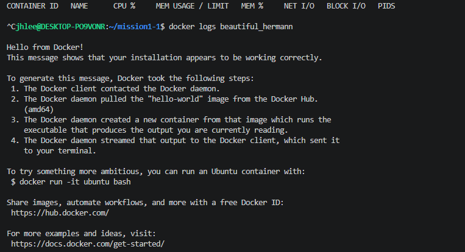    

---

### 4-5. 컨테이너 실행 실습

    # hello-world 실행
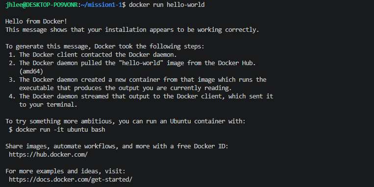
    
    # ubuntu 컨테이너 실행 후 간단 명령
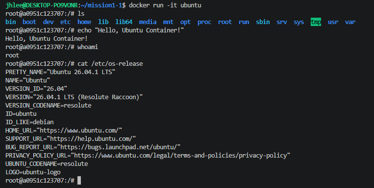
    
### attach vs exec 차이

| 구분 | attach | exec |
|------|--------|------|
| 연결 대상 | 메인 프로세스(PID 1) | 새 프로세스 |
| exit 시 | 컨테이너 종료됨 | 컨테이너 계속 실행 |
| 용도 | 메인 로그 확인 | 추가 명령 실행/디버깅 |

---

### 4-6. Dockerfile 기반 커스텀 이미지

    # 이미지 베이스
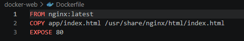
    
    # 내가 적용한 커스텀 포인트
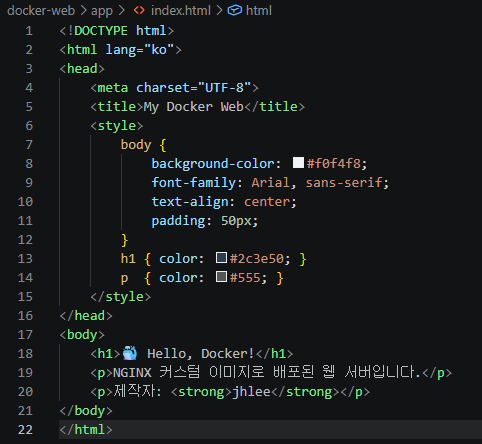

    # 빌드/실행 명령 + 핵심 결과
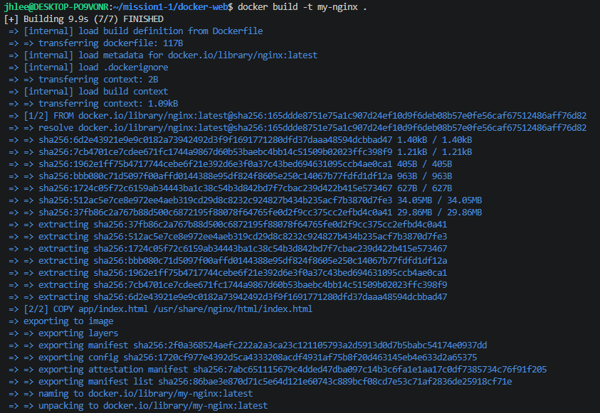
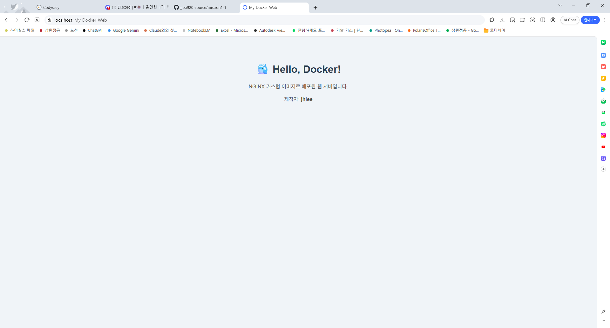
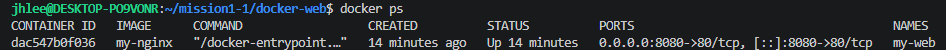

### 4-7. 포트 매핑 및 접속 증거
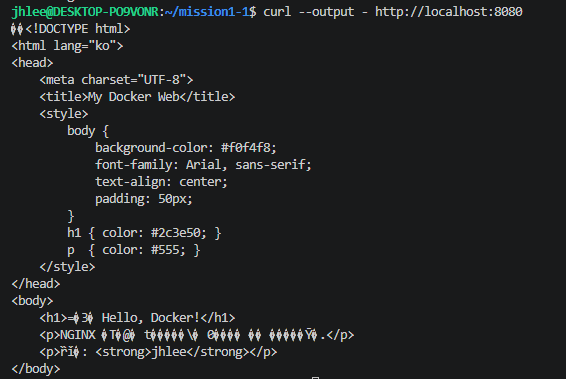

---

### 4-8. Docker 볼륨 영속성 검증

    # Docker 볼륨을 생성, 컨테이너 연결
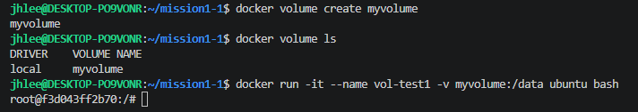

    # 컨테이너 삭제 전/후 데이터 영속성 확인
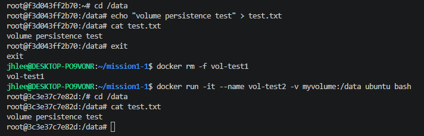

### 볼륨 vs 바인드 마운트 비교
| 구분 | 볼륨 | 바인드 마운트 |
|------|------|--------------|
| 저장 위치 | Docker 관리 영역 | 호스트 지정 경로 |
| 주 용도 | 데이터 영속성 보장 | 개발 중 실시간 반영 |
| 컨테이너 삭제 후 | 데이터 유지 | 데이터 유지 |

---

### 4-9. Git 설정 및 GitHub 연동

    # Git 사용자 정보/기본 브랜치 설정
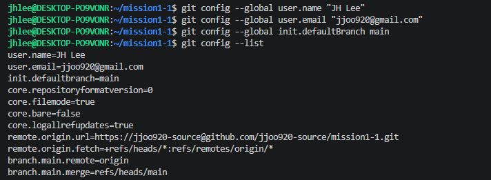

---

### 4-10. 보안 및 개인정보 보호
    
    # 민감 정보에 대한 마스킹
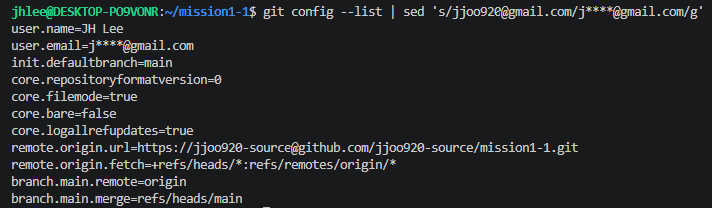

---

## 5. 트러블슈팅

### Case 1: docker --version 명령어 실패

    # docker 명령어를 윈도우 shell에서 실행하여 실패
      → wsl로 재접속하여 docker --version 명령어 실행
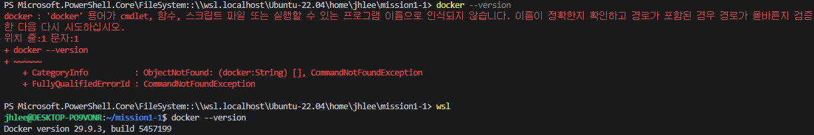

### Case 2: docker 명령어 실행시 권한 부족

    # docker images 명령어 실행하였으나 권한 부족으로 실패
      → supervisedo 추가하여 명령 수행
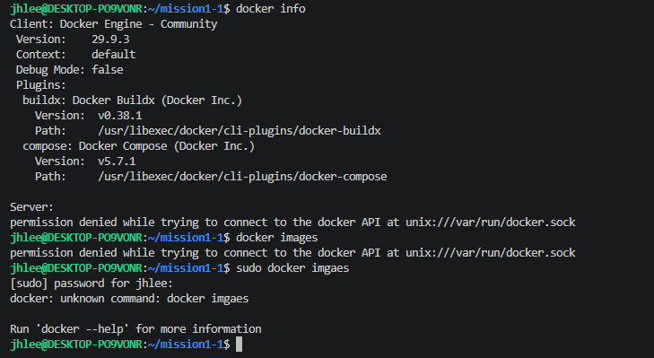

---

### 절대경로 vs 상대경로 선택 기준

### 개념 비교
| 구분 | 형식 예시 | 설명 |
|------|-----------|------|
| 절대경로 | `/home/user/app` | 루트(/)부터 시작하는 전체 경로 |
| 상대경로 | `${PWD}/app` | 현재 작업 디렉토리 기준 경로 |

### 장단점 비교
| 구분 | 절대경로 | 상대경로 |
|------|----------|----------|
| 장점 | 경로가 명확하여 오류 없음 | 환경이 달라도 유연하게 동작 |
| 단점 | 다른 환경에서 경로 수정 필요 | 실행 위치에 따라 경로 달라짐 |
| 사용처 | 컨테이너 내부 경로 지정 시 | 로컬 개발 환경 볼륨 마운트 시 |

### 선택 기준
| 상황 | 권장 방식 | 이유 |
|------|-----------|------|
| 컨테이너 내부 경로 | ✅ 절대경로 | 컨테이너 내부는 항상 동일한 경로 구조 |
| 로컬 볼륨 마운트 | ✅ 상대경로(`${PWD}`) | 팀원마다 로컬 경로가 다를 수 있음 |
| 스크립트 배포 자동화 | ✅ 절대경로 | 실행 위치와 무관하게 안정적 동작 |
| 개발 중 테스트 | ✅ 상대경로 | 빠르게 경로 변경 가능 |

### 본 프로젝트 적용 예시
    # 상대경로 사용 (로컬 개발 환경)
    docker run -d \
    -v ${PWD}/app:/usr/share/nginx/html \  ← 로컬 경로: 상대경로
    -p 8080:80 \
    --name my-web my-nginx

    # 컨테이너 내부 경로는 절대경로 고정
    /usr/share/nginx/html  ← 컨테이너 내부: 절대경로

---

## 6. 참고 자료

- Docker 공식 문서: https://docs.docker.com
- Git 공식 문서: https://git-scm.com/doc
- nginx 공식 이미지: https://hub.docker.com/_/nginx
- Linux 권한 계산: https://chmod-calculator.com